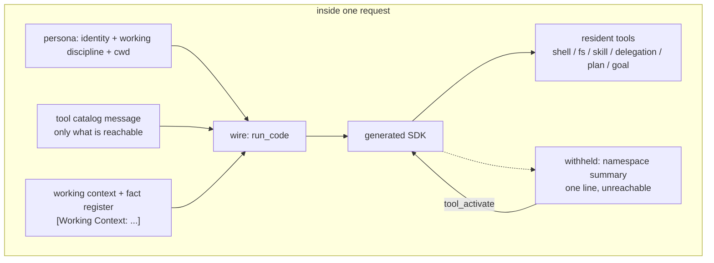

<div align="center">

<h1>dsh-liangheng</h1>

<p><strong>LiangHeng: a DeepSeek Harness agent preset derived from LiangShen — one-line persona, one wire presentation declared for the whole session, tool families that page in on demand.</strong></p>

<p><a href="README.md">简体中文</a> · <a href="README.en.md">English</a></p>

<p>
  <a href="LICENSE"></a>
  <a href="package.json"></a>
  <a href="package.json"></a>
  
</p>

<p>
  <a href="#features">Features</a> ·
  <a href="#how-it-works">How it works</a> ·
  <a href="#quick-start">Quick start</a> ·
  <a href="#configuration">Configuration</a> ·
  <a href="#catalog-and-paging">Catalog &amp; paging</a> ·
  <a href="#known-limitations">Limitations</a>
</p>

<p><code>dsh plugin --profile web add link:$PWD</code></p>

</div>

---

> [!IMPORTANT]
> **Upstream baseline.** This tree is the unmodified v0.4.21 source of
> [`@linxin666/dsh-liangshen`](https://www.npmjs.com/package/@linxin666/dsh-liangshen) (Apache-2.0)
> plus the build tooling that tarball withholds; LiangHeng's own changes have not landed yet.
> `package.json` still declares the upstream name, so **do not install this next to the upstream
> plugin** — they collide. Exactly one source file differs from the tarball:
> `presets/liangshen/agent.cordis.yml`, whose `persona.prefix` carries a local working-discipline
> prompt in place of upstream's short English persona.

`dsh-liangheng` is a [DeepSeek Harness](https://www.npmjs.com/package/@deepseek-ai/dsh) agent preset
**derived from [LiangShen](docs/upstream/README.en.md)**. It treats "how many tool definitions the
model must read every turn" as a budget you can tune: one wire form for the whole session,
high-fan-out families that page in on demand, and discoverability carried by a durable message
rather than by keeping every schema resident in the request.

<details>
<summary><strong>Contents</strong></summary>

- [Why this fork](#why-this-fork)
- [Features](#features)
- [Requirements](#requirements)
- [Quick start](#quick-start)
- [How it works](#how-it-works)
- [Tool surface](#tool-surface)
- [Configuration](#configuration)
- [Catalog and paging](#catalog-and-paging)
- [Verifying a session](#verifying-a-session)
- [Development](#development)
- [Known limitations](#known-limitations)
- [Changes from the upstream baseline](#changes-from-the-upstream-baseline)
- [Attribution](#attribution)
- [Contributing](#contributing)
- [License](#license)

</details>

## Why this fork

A standard preset keeps every tool's JSON schema on the wire for the whole session. That is
predictable, and unbounded: one MCP-heavy environment measured **289 tools** across three
namespaces, with the PTC `interface ToolArgsMap` block alone worth roughly **73k characters** of a
105k-character assembled prompt.

LiangShen pays that bill down with three moves. This repository starts from its result so the
follow-up work can change the trade-off instead of rediscovering it:

1. **Declared once, one form.** `ptc` collapses the wire to a single `run_code` and every other tool
   travels through the generated SDK; `native` keeps the assembled roster. The catalog does not
   move when plan mode toggles, so the prefix stays warm.
2. **Paging instead of flat listing.** High-fan-out families are absent from the wire *and* from the
   generated SDK until `tool_activate` loads the namespace.
3. **Discoverability moved into a message.** One durable user message lists exactly the tools the
   request carries, so the surface shrinks without the model going blind.

## Features

- **Single wire presentation:** `presentation` decides the session's form once; nothing switches
  mid-session and plan mode never changes the catalog.
- **Gentle paging:** seven families start withheld (`mcp__*`, `browser_*`, `task_board_*`, `team_*`,
  `squad*`, `ui_*`, `ssh_*`); at most three namespaces stay active, LRU evicted, state replayed from
  the session event stream.
- **Tool catalog message:** announces only what the request actually has, with a signature summary
  each, plus one line per withheld namespace. Republished only when the surface changes or a
  published copy leaves the visible surface (compaction, resume).
- **Working context line:** one `[Working Context: ...]` projection of plan state, active
  namespaces, in-progress todos and the fact register, republished only on change.
- **Fact register:** `fact_register` pins hard constraints, confirmed decisions and failed paths as
  one short line, folded back every step — a direct counter to long-session forgetting.
- **Delegation guards:** `subagent-routes` forces every policed delegation onto a Session-authorized
  route (inherit-only forks included); `dispatch-guard` refuses coordinator-only tools and bare sleep
  loops from a child.
- **Composer lever:** a control left of the model selector switches the mode on the new-session
  screen; it disappears once the session has content.

## Requirements

| Component | Requirement |
|---|---|
| DSH | `>= 0.2.2-rc.3`; this tree builds against the `0.2.2-rc.5` dependency tree |
| Node.js | `>= 24.9.0` (ESM only) |
| Build | npm or pnpm; `tsdown` 0.22.2 with `@tsdown/css` 0.22.2 (exact pair) |
| Runtime | The host must mount a PTC executor for `ptc`; without one it falls back to the native roster |

## Quick start

### 1. Build

```sh
npm install
npm run build      # tsc -b tsconfig.build.json && tsdown -> lib/
```

`lib/` is committed, so a `link:` install needs no build — only source changes do.

### 2. Install into a profile

```sh
dsh plugin --profile web add link:$PWD
```

### 3. Pick the preset

Restart `dsh web` completely, open a **new, empty** session and select it. A session with content
cannot be recomposed — the host refuses to switch presets mid-session.

## How it works



<sub>Figure: a withheld family is unreachable in three places at once — wire, SDK, and program
dispatch — and joins the SDK only after activation.</sub>

### Enforced twice

Paging is not a wire filter. The assembled tool list loses the family *and*
`agent.ctx.tools.restrict` withholds it, so a `run_code` program cannot reach it either — under
`ptc` the wire is already one `run_code`, so a wire-only filter would withhold nothing observable.

### Nothing lives in process memory

The active set, LRU recency and the fact register are all folded from the durable session event
stream. Compaction and resume rebuild them identically; a process restart loses nothing.

## Tool surface

| Group | Tools | Resident |
|---|---|---|
| Shell | `bash` (POSIX) / `pwsh` (win32), exactly one per platform | yes |
| Files | `read` / `write` / `edit` / `glob` / `grep` / `str_replace_editor` (16k chars) / `read_image` | yes |
| Orchestration | `todo_write`, `ask_user_question`, `skill`, `plan`, `goal`, `fact_register`, `tool_activate` | yes |
| Delegation | `subagent` (routable, `backgroundMode: continuable`), `subagent_fork`, `subagent_codex`, `subagent_claude_code`, `ralph` (<= 64 rounds) | yes |
| Web | `web_search`; `web.fetch` is off, pages are not fetched | yes |
| High fan-out | `mcp__*`, `browser_*`, `task_board_*`, `team_*`, `squad*`, `ui_*`, `ssh_*` | paged |

Standard rows this preset does **not** mount: `time-context`, `tool-schedule`, `present`,
`tool-office`, plugin-manager / market.

## Configuration

Every switch lives in `presets/liangshen/agent.cordis.yml`.

| Key | Row | Default | Effect |
|---|---|---|---|
| `presentation` | `tool-catalog` | `ptc` | Wire form for the whole session: `ptc` = `run_code` only, `native` = assembled roster |
| `pagedToolPatterns` | `tool-catalog`, `tool-activate`, `working-context` | the seven families above | Namespaces withheld until activated; **must be identical in all three rows** |
| `maxResidentTokens` | `tool-catalog` | `8000` | Warns once when the resident surface outgrows the estimate; never truncates |
| `idleReclaimSteps` | same three rows | `0` | `0` keeps activations until LRU eviction; `N` expires idle namespaces at the next activation or compaction boundary |
| `descriptionMaxLength` | `tool-catalog` | `200` | One-line summary budget per tool; curated entries keep their full hand-written line |
| `instructionSource` | `minimal-prompt` | `host` | How `AGENTS.md` reaches the model: `host` (user messages), `system-prompt`, `hint` |
| `instructionMaxBytes` | `minimal-prompt` | `65536` | Byte budget for the rendered section in `system-prompt` mode |
| `keepPlanPolicy` | `minimal-prompt` | `true` | Keeps the plan-mode section in the otherwise one-line prompt |
| `keepSections` | `minimal-prompt` | `[]` | Extra prompt sections admitted by name |
| `dispatcher` | `minimal-prompt` | `true` | Appends the dispatcher rule block to the persona; off returns the bare persona |

Sub-processor defaults that differ from the built-in presets: `web.fetch` off, tool-result pruning
at **4096 / 2048 / 1024** chars (built-ins: 8192 / 4096 / 1024), `str_replace_editor` capped at
16k chars, `ralph` limited to 64 rounds.

## Catalog and paging

- A namespace is derived from the pattern head: a head ending in `__` is an MCP bridge and takes the
  first `__` segment of the tool name (`mcp__codegraph__x` -> `codegraph`); any other head names the
  family literally with one trailing `_` dropped (`task_board_*` -> `task_board`, `squad*` ->
  `squad`).
- Activating, or successfully calling a tool inside an active family, refreshes recency; a fourth
  activation evicts the least recently used namespace back to its summary line.
- A failed call changes nothing: it neither activates nor refreshes.
- `pagedToolPatterns` is **one fact declared three times**: `tool-catalog` installs the registry
  restriction, `tool-activate` replays the log to answer activations, and `working-context` renders
  the active set. A mismatch leaves a namespace the catalog withholds while the activation tool
  still calls it active.

## Verifying a session

```sh
node tools/analyze-session.mjs <exported-session.jsonl>
```

Or read the exported JSONL directly:

- the first `request/header` carries only `run_code`;
- the tool catalog message lists exactly the tools that request has;
- after `tool_activate`, the next header is still a single `run_code`, and the activated family
  appears in the generated SDK;
- after compaction or resume, catalog and context are rebuilt from the event stream and match what
  came before.

## Development

```sh
npm install
npm run build      # tsc -b tsconfig.build.json && tsdown -> lib/
npm run typecheck  # tsc --noEmit
npm test           # vitest run (55 tests)
```

Output: `lib/index.js` (host half), `lib/client.js` (browser half, importing `lib/style.css` beside
it) and `lib/types/**` declarations from `tsc -b`.

Details in [CONTRIBUTING.md](CONTRIBUTING.md).

## Known limitations

1. **`ptc` is the default, and the vendor's own comparison puts native ahead** — 72.6% vs 67.6% on
   DeepSWE v1.1, 90.6% vs 85.8% on Terminal-Bench 2.1. `native` is one line away; this is a
   context-saving trade against accuracy, not a free lunch.
2. **One indirection layer.** A paged tool must be activated before it exists, and the catalog
   carries summaries rather than full schemas.
3. **Three copies of one fact.** A `pagedToolPatterns` mismatch leaves a dead spot; change one, change
   all.
4. **Paged state is derived.** It replays from the event stream, so a truncated or hand-edited log
   changes what the session believes is active.
5. **CSS packaging differs from upstream.** Upstream inlines it into `client.js`; this build emits
   `style.css` plus a JS import. Confirm styling in a real session after install.
6. **No mid-session switch.** Once a session has content the host refuses to recompose it; choose
   the preset on a new session.

## Changes from the upstream baseline

1. **Added** `tsconfig.json`, `tsconfig.build.json`, `tsdown.config.ts`, `vitest.config.ts`,
   `.gitignore` — the tarball ships `build`/`test` scripts without their configs.
2. **`package.json`** — `typecheck` runs `tsc --noEmit` (`tsgo` is not a declared dependency);
   `@tsdown/css@0.22.2` added, pinned to the exact peer `tsdown@0.22.2` demands; `lib/**/*.css`
   added to `files`.
3. **`src/composition.test.ts`** — two assertions matched the upstream persona wording verbatim;
   they now assert the structural fact under test (a multi-line literal scalar ending at the next
   composition row), so rewording the persona no longer breaks the suite.
4. **Docs** — upstream READMEs moved to `docs/upstream/`; `README.i18n.yaml` removed (its
   verification script is not published).

## Attribution

- **LiangShen (梁神模式)** — [`@linxin666/dsh-liangshen`](https://www.npmjs.com/package/@linxin666/dsh-liangshen)
  v0.4.21, Apache-2.0, © zhu1090093659. Origin of `src/`, `presets/`, `locale/` and `tools/`;
  notices in [LICENSE](LICENSE) and [presets/liangshen/NOTICE](presets/liangshen/NOTICE).
- **DeepSeek Harness built-in presets** — `agent.cordis.yml` is adapted from the built-in `minimal`,
  `standard` and `ptc` presets (MIT).
- **dsh-anchored-standard** — <https://github.com/xiaobright/dsh-anchored-standard> (MIT), whose
  findings shape the injection design.

## Contributing

See [CONTRIBUTING.md](CONTRIBUTING.md). Before editing `presets/liangshen/agent.cordis.yml`, read
[Catalog and paging](#catalog-and-paging): the three-copy fact leaves a dead spot when one copy is
missed.

## License

[Apache-2.0](LICENSE).
