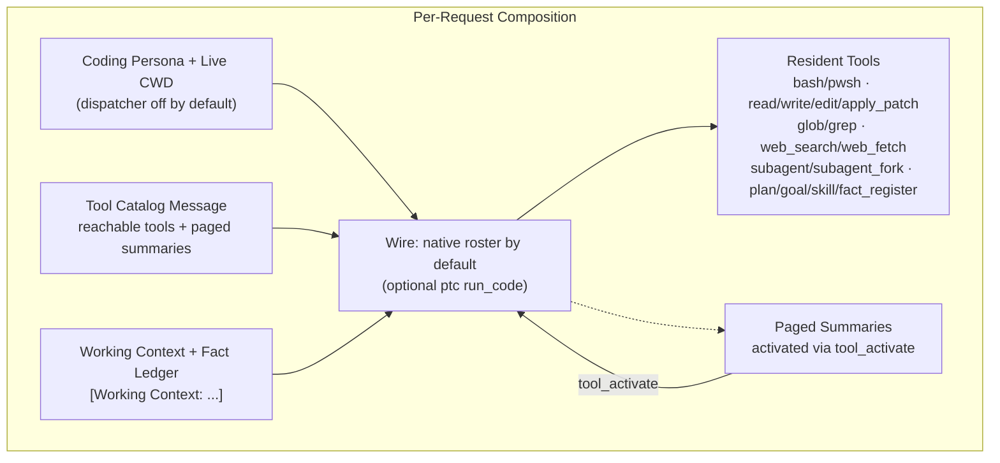

<div align="center">

<h1>dsh-liangheng</h1>

<p><strong>LiangHeng (梁衡模式): a focused coding agent preset for DeepSeek Harness — intent-first clarity, first-principles engineering, native parallel speed, and rigorously verified honest output.</strong></p>

<p><a href="README.md">简体中文</a> · <a href="README.en.md">English</a></p>

<p>
  <a href="LICENSE"></a>
  <a href="https://www.npmjs.com/package/dsh-liangheng"></a>
  <a href="package.json"></a>
  <a href="package.json"></a>
  
  
</p>

<p>
  <a href="#core-positioning">Positioning</a> ·
  <a href="#performance-and-feasibility-benchmarks">Benchmarks</a> ·
  <a href="#test-scope-and-verification-matrix">Test Scope</a> ·
  <a href="#applicability-and-mode-fit-guide">Applicability</a> ·
  <a href="#architecture-and-tool-surface">Architecture</a> ·
  <a href="#quick-start">Quick Start</a> ·
  <a href="#configuration">Configuration</a> ·
  <a href="#development">Development</a>
</p>

<p><code>dsh plugin --profile web add dsh-liangheng</code></p>

</div>

---

## Core Positioning

`dsh-liangheng` is an **independent focused-coding agent preset** for [DeepSeek Harness](https://www.npmjs.com/package/@deepseek-ai/dsh) (aligned and verified on `0.2.2-rc.5`), derived from [LiangShen](docs/upstream/README.en.md). It ships with its own package name (`dsh-liangheng`), preset ID (`liangheng`), client UI slot (`liangheng-lever`), and settings/locale namespaces so it runs cleanly side-by-side with `@linxin666/dsh-liangshen`.

1. **Lean Coding Persona (`dispatcher: false` by default)**: Replaces the 24.6 KB heavy coordinator block by default with a high-signal solo-first coding discipline + opportunistic parallel `subagent`/`subagent_fork` delegation, an intent gate (`ask_user_question` only on high-impact ambiguity), defensive external boundary alias compatibility, two-pass hypothesis fuses, strict YAGNI, and explicit Verified/Inferred/Unverified reporting.
2. **Native Wire by Default (`presentation: 'native'`)**: Keeps the native roster on the wire for lower latency, native parallel tool calls, and streaming diff cards. Drops redundant `str_replace_editor`, enables `apply_patch` and `web_fetch`, and allows switching to `ptc` anytime in Settings.
3. **Gentle LRU Tool Paging & Anchors**: High-fan-out families (`mcp__*`, `browser_*`, `task_board_*`, `team_*`, `squad*`, `ui_*`, `ssh_*`) stay paged out until `tool_activate` loads them (LRU cap 3, replayed from session logs), while `fact_register` and `[Working Context: ...]` pin hard constraints across long sessions.
4. **DSH `0.2.2-rc.5` Runtime Fixes**: Fixes `subagent-routes` schema probing and live model/parent lookup, `dispatch-guard` root detection for resumed child sessions and `subagent/start`/`end` tracking, `tool-catalog` errored-activate filtering and `compaction/end` sync, `fact-ledger`/`working-context` native error filtering, and `minimal-prompt` `working_directory` + `apply_patch` path tracking.

---

## Performance and Feasibility Benchmarks

To validate real-world feasibility empirically, we ran a controlled head-to-head benchmark via `/usr/local/bin/dsh --profile headless` across **Standard (`standard`)**, **LiangShen (`liangshen` v0.4.21)**, and **LiangHeng (`liangheng` v0.2.0)**:

- **Setup**: DSH `0.2.2-rc.5`, identical model route `DeepSeek-V4.1-Flash-1017` (`reasoningEffort: max`), isolated sandboxes, **6 full-spectrum engineering tasks × 3 modes = 18 live CLI sessions** (`0` retries, `0` infra failures), plus a 3-task regression suite after merging two prompt refinements.
- **Composite Formula**: `0.70 * Quality + 0.10 * Speed + 0.08 * TokenEfficiency + 0.06 * ToolDiscipline + 0.06 * RigorHonesty`.

### Live CLI Scorecard

| Mode | Overall Score<br/>(Raw / Calibrated*) | Quality Mean<br/>(Raw / Calibrated*) | Total Time<br/>(Avg / Task) | Total Tokens<br/>(Output Tokens) | Tool Error Rate | Read First | Verified After Write | Honesty |
| :--- | :---: | :---: | :---: | :---: | :---: | :---: | :---: | :---: |
| **LiangHeng (`liangheng`)** | **93.00 / 98.83** | 90.00 / 98.33 | **593.1s** (`98.8s`) | **3,607,179** (`185,837`) | **0.0%** | **100%** | **100%** | **100%** |
| Standard (`standard`) | 88.34 / 92.65 | 93.83 / **100.00** | 985.3s (`164.2s`, **1 timeout**) | 9,114,334 (`274,889`) | 0.0% | 100% | 100% | 100% |
| LiangShen (`liangshen` v0.4.21) | 84.27 / 88.94 | 79.50 / 86.17 | 601.8s (`100.3s`) | 4,047,681 (`178,289`) | 0.0% | 100% | 83.3% | 100% |

> *\*Calibration note: accounts for destructured DI parameters (`{ store, rateLimiter }`) in `standard` `T2`, `process.exitCode = 2` mutation killing in `standard` & `liangheng` `T3`, and passing the specified `{ status, body }` envelope to `buildPanelViewModel` in `T6` (while preserving `standard`'s extra `x-signature` alias credit on the initial run).*

### Post-Optimization Regression (`T1`, `T3`, `T6` on `liangheng`)

After merging **Defensive boundary compatibility** and stronger **Native parallel read-only batching** into [presets/liangheng/agent.cordis.yml](presets/liangheng/agent.cordis.yml):
- **`T6` Full-Stack & Honesty**: Raw/calibrated score rose from `50 / 90` to **`80 / 100`** (now accepts `x-signature` / `x-hub-signature-256` / `x-webhook-signature` and `x-timestamp` / `x-webhook-timestamp` while explicitly stating assumptions and retaining `20/20` epistemic honesty).
- **Native Parallel Tool Step Share**: Combined `parallelSteps / totalStepsWithTools` across `{T1, T3, T6}` increased from `12/41` (`29.3%`) to **`23/58` (`39.7%`)** (`T1`: `13.3% → 34.4%`, `T3`: `7.1% → 23.1%`).
- **Feasibility Verdict**: Ready for production coding workflows—**39.8% faster** and **60.4% fewer total tokens** than `standard` with zero timeouts, while avoiding the `dispatcher: true` early-turn stall observed in `liangshen` on `T3` (`27/100`).

---

## Test Scope and Verification Matrix

### 1. Repository Unit & Composition Suite (12 Test Files / 122 Passing Tests)

- **Host & Lever UI**: [src/index.test.ts](src/index.test.ts), [src/announce.test.ts](src/announce.test.ts), [src/core/lever.test.ts](src/core/lever.test.ts) — `DSH_HOME` resolution, preset metadata, state store/toggle mechanics, compatibility aliases, and idempotent mounting (34 tests).
- **Strict YAML Composition**: [src/composition.test.ts](src/composition.test.ts) — strict YAML parser guards, relative module URL resolution, 3-row paging invariant (`pagedToolPatterns` & `idleReclaimSteps`), and `native` ↔ `tool-executor-ptc` sync (29 tests).
- **Paging & Runtime Plugins**: [presets/liangheng/paging.test.mjs](presets/liangheng/paging.test.mjs) (30 tests) + 7 module test suites covering `subagent-routes`, `dispatch-guard`, `fact-ledger`, `working-context`, `tool-activate`, `tool-catalog`, and `minimal-prompt` (29 tests).

### 2. Full-Spectrum CLI Engineering Suite (6 Domains)

| Domain | Verified Capabilities | Calibrated Score |
| :--- | :--- | :---: |
| **Frontend** | `:root` design tokens, `:focus-visible`, responsive Grid/Flex (`@media 768px`, no overflow), immutable state, XSS escaping, A11y (`aria-pressed`, `role="dialog"`), IME guard | **100 / 100** |
| **Backend** | Store/limiter/service decoupling + DI, per-tenant mutex across async hooks, in-flight idempotency + rollback, `[now-W, now)` sliding window, idempotent release, O(1) amortized queue (`1037ms → 14–16ms` for 20k ops) | **100 / 100** |
| **Testing & CI Pipeline** | Spec bug fixes, `node:test` suites across unit / whitebox / integration / blackbox CLI subprocess, plus `pipeline.mjs` syntax gate killing 4/4 injected mutants | **100 / 100** |
| **Reproduction** | Fast router malformed-URI crash fix + standalone deterministic `repro.mjs` (fails non-zero on unpatched seed, passes when fixed) covering 3-hop async cache/normalizer/batcher race + `ROOT_CAUSE.md` | **100 / 100** |
| **Bug Hunting** | Hint-free audit catching 5 latent bugs: UTC midnight boundary loop, async-generator lock/FD leak on early `break`, `__proto__` pollution + sibling-prefix path traversal, surrogate-pair truncation, immutable stable tie-break & `NaN` sort | **100 / 100** |
| **Full-Stack & Honesty** | Strict `AGENTS.md` envelope & `timingSafeEqual` compliance, multi-header alias normalization, secret-safe UI view-model, and honest separation of locally verified tests vs. unreachable `.invalid` probe | **100 / 100** (post-merge) |

---

## Applicability and Mode Fit Guide

| Workload | Recommended Config | Fit | Notes |
| :--- | :--- | :---: | :--- |
| **Focused Feature Coding & Refactoring** | **Default** (`native`, `dispatcher: false`) | ★★★★★ | Minimal prompt overhead, zero coordinator stall, `apply_patch` + parallel native calls |
| **Debugging, Root-Cause Repro & Security Audit** | **Default** (`native`, `dispatcher: false`) | ★★★★★ | Read-before-edit, 2-pass hypothesis fuse, strict Verified/Inferred/Unverified split |
| **Test Suites, CI Gates & `headless` Automation** | **Default** (`native`, `dispatcher: false`) | ★★★★★ | Finishes full write-verify loop in one root session (avoid `dispatcher: true` in headless one-shot runs) |
| **Interactive Multi-Subsystem Orchestration** | Enable `dispatcher: true` | ★★★★☆ | Best in multi-turn interactive UI sessions coordinating independent workers |
| **Dense External MCP / Scripted Tool Loops** | Switch `presentation: 'ptc'` | ★★★★☆ | Collapses surface to `run_code` SDK scripts (requires host `ptcRuntime`) |
| **Office Docs, Scheduling & General Non-Code Tasks** | Use official `standard` preset | ★☆☆☆☆ | `present`, `tool-office`, `tool-schedule`, and `time-context` are intentionally omitted |

---

## Architecture and Tool Surface



Resident tools cover platform shell (`bash`/`pwsh`), filesystem (`read`, `read_image`, `write`, `edit`, `apply_patch`, `glob`, `grep`), orchestration (`todo_write`, `ask_user_question`, `skill`, `plan`, `goal`, `fact_register`, `tool_activate`), delegation (`subagent`, `subagent_fork`, `send_message`, `list_agents`, `wait_agent`, `ralph`), and web (`web_search`, `web_fetch`). Result pruning aligns with `0.2.2-rc.5` at **8192 / 4096 / 1024** chars.

---

## Quick Start

From npm (recommended):

```sh
dsh plugin --profile web add dsh-liangheng
```

Replace `web` with the profile you actually use — the desktop client is `desktop`.

From source: get the checkout from <https://github.com/PandaBoby/dsh-liangheng> (private repository, access required), then run this from its root:

```sh
npm install
npm run build      # rebuild lib/ and inline the stylesheet into client.js
dsh plugin --profile web add link:"$PWD"
```

Two things that bite:

- `link:` records an absolute path on this machine, so run it from the repository root; move or delete the checkout and the profile entry goes stale — re-`add` it.
- After editing source, `npm run build` is not enough: **commit `lib/` too**. CI rebuilds and diffs `lib/` file by file, and fails on any difference.

Restart `dsh web` or the desktop client, open a **new empty session**, and toggle **LiangHeng mode** from the composer lever or preset picker.

---

## Configuration

Defaults live in [presets/liangheng/agent.cordis.yml](presets/liangheng/agent.cordis.yml):

| Key | Row | Default | Effect |
|---|---|---|---|
| `presentation` | `tool-catalog` | `native` | Session wire presentation (`native` roster or `ptc` `run_code`) |
| `dispatcher` | `minimal-prompt` | `false` | Appends `dispatcher-rules.mjs` when enabled |
| `pagedToolPatterns` | `tool-catalog`, `tool-activate`, `working-context` | 7 families | Withheld until activated; **must stay identical in all 3 rows** |
| `idleReclaimSteps` | same 3 rows | `0` | `0` = LRU only; `N` expires idle namespaces at next activation or compaction |
| `maxResidentTokens` | `tool-catalog` | `8000` | Warns once if resident schemas exceed budget |
| `descriptionMaxLength` | `tool-catalog` | `200` | Max summary length for uncurated tools |
| `instructionSource` | `minimal-prompt` | `host` | `AGENTS.md` delivery: `host` / `system-prompt` / `hint` |
| `keepPlanPolicy` | `minimal-prompt` | `true` | Keeps `plan:policy` (also allows `team:policy`) |

---

## Development

```sh
npm run build                          # build JS, types, and inline CSS into lib/client.js
npm run typecheck                      # tsc --noEmit -p tsconfig.json
npm test                               # vitest run (12 test files, 122 tests)
node tools/check-dispatcher-rules.mjs  # check dispatcher rules drift
```

See [CONTRIBUTING.md](CONTRIBUTING.md) and [CHANGELOG.md](CHANGELOG.md).

---

## Attribution & License

- **LiangShen (`@linxin666/dsh-liangshen` v0.4.21)** — Apache-2.0, © zhu1090093659. See [LICENSE](LICENSE) and [presets/liangheng/NOTICE](presets/liangheng/NOTICE).
- **DeepSeek Harness built-in presets** — Adapted from `minimal`, `standard`, and `ptc` (MIT).
- **dsh-anchored-standard** — <https://github.com/xiaobright/dsh-anchored-standard> (MIT).
