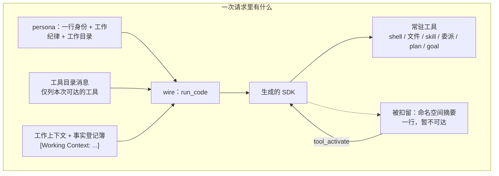

<div align="center">

<h1>dsh-liangheng</h1>

<p><strong>梁衡模式：衍生自梁神模式的 DSH agent preset——一行 persona、整个会话只声明一次的 wire 呈现、按需分页进场的工具族。</strong></p>

<p><a href="README.md">简体中文</a> · <a href="README.en.md">English</a></p>

<p>
  <a href="LICENSE"></a>
  <a href="package.json"></a>
  <a href="package.json"></a>
  
</p>

<p>
  <a href="#功能">功能</a> ·
  <a href="#工作原理">工作原理</a> ·
  <a href="#快速开始">快速开始</a> ·
  <a href="#配置">配置</a> ·
  <a href="#目录与分页">目录与分页</a> ·
  <a href="#已知限制">已知限制</a>
</p>

<p><code>dsh plugin --profile web add link:$PWD</code></p>

</div>

---

> [!IMPORTANT]
> **当前是上游基线。** 本树是 [`@linxin666/dsh-liangshen`](https://www.npmjs.com/package/@linxin666/dsh-liangshen)
> v0.4.21 未经修改的源码（Apache-2.0），加上发布包未包含的构建工具链；梁衡自己的改动尚未落地。
> `package.json` 仍声明上游包名，**不要与上游插件同时安装**——两者会冲突。
> 与发布包相比只有一个源文件不同：`presets/liangshen/agent.cordis.yml` 的 `persona.prefix`
> 换成了本机的工作纪律提示词，取代上游那段简短英文 persona。

`dsh-liangheng` 是 [DeepSeek Harness](https://www.npmjs.com/package/@deepseek-ai/dsh) 的一个 agent
预设，**衍生自 [梁神模式（LiangShen）](docs/upstream/README.zh.md)**。它把「模型每轮要读多少工具定义」
当成一个可调节的预算：整个会话只用一种 wire 形态，高扇出的工具族按需分页进场，工具的可发现性由一条
持久消息承担，而不是靠把 schema 常驻在请求里。

<details>
<summary><strong>目录</strong></summary>

- [为什么做这一支](#为什么做这一支)
- [功能](#功能)
- [要求](#要求)
- [快速开始](#快速开始)
- [工作原理](#工作原理)
- [工具面](#工具面)
- [配置](#配置)
- [目录与分页](#目录与分页)
- [验证](#验证)
- [开发](#开发)
- [已知限制](#已知限制)
- [相对上游基线的改动](#相对上游基线的改动)
- [归属与致谢](#归属与致谢)
- [参与贡献](#参与贡献)
- [许可证](#许可证)

</details>

## 为什么做这一支

标准预设会把每个工具的 JSON schema 全程挂在 wire 上。这很可预测，但没有上限：在一个装满 MCP 的
环境里实测到 **289 个工具**分布在三个命名空间，其中仅 PTC 的 `interface ToolArgsMap` 一段就占组装后
提示词约 **7.3 万字符**（整个提示词 10.5 万字符）。

梁神模式用三招削这笔账。本仓库直接站在它的结果上，好让后续工作去改这个取舍，而不是重新发现一遍：

1. **一次声明，全程同一呈现。** `ptc` 把 wire 收拢为一个 `run_code`，其余工具经生成的 SDK 调用；
   `native` 保留组装出的原生清单。plan mode 切换时工具目录不变，前缀缓存得以保持。
2. **分页代替平铺。** 高扇出工具族既不在 wire 上、也不在生成的 SDK 里，直到 `tool_activate` 激活该
   命名空间。
3. **把可发现性挪进消息。** 一条持久 user 消息逐项列出本次请求实际携带的工具，工具面缩小了，模型
   也没有变成瞎子。

## 功能

- **单一 wire 呈现：** `presentation` 决定整个会话的形态，会话中途不切换，也不因 plan mode 抖前缀。
- **温和分页：** 默认扣留 `mcp__*`、`browser_*`、`task_board_*`、`team_*`、`squad*`、`ui_*`、`ssh_*`
  七个族；同时最多三个命名空间活跃，LRU 驱逐，激活状态从会话事件流重放。
- **工具目录消息：** 只宣告本次请求真正拥有的工具（含签名摘要），并为被扣留的命名空间各附一行摘要；
  只有工具面变化或库存离开可见面（压缩、恢复）时才重发。
- **工作上下文行：** 一行 `[Working Context: ...]` 投影 plan 状态、活跃命名空间、进行中的 todo 与
  事实登记簿，只在内容变化时重发。
- **事实登记簿：** `fact_register` 把硬性约束、已确认决策、失败过的路径钉成一行，每步折叠回来——
  这是对长会话遗忘的直接对冲。
- **委派守卫：** `subagent-routes` 强制每条被管辖的委派落到会话授权路由（含只能继承的 fork）；
  `dispatch-guard` 拒绝子代理调用协调者专用工具，以及空转的 sleep 等待。
- **输入框拨杆：** 新建会话页模型选择器左侧的控件用于切换本模式，会话一旦有内容即消失。

## 要求

| 组件 | 要求 |
|---|---|
| DSH | `>= 0.2.2-rc.3`；本仓库在 `0.2.2-rc.5` 的依赖树构建通过 |
| Node.js | `>= 24.9.0`（纯 ESM） |
| 构建 | npm 或 pnpm；`tsdown` 0.22.2 + `@tsdown/css` 0.22.2（精确配套） |
| 运行时 | 宿主需挂载 PTC 执行器才能使用 `ptc` 呈现；缺失时回落到原生清单 |

## 快速开始

### 1. 构建

```sh
npm install
npm run build      # tsc -b tsconfig.build.json && tsdown -> lib/
```

`lib/` 已提交进仓库，`link:` 安装无需构建；只有在改源码时才需要这一步。

### 2. 装进 profile

```sh
dsh plugin --profile web add link:$PWD
```

### 3. 选择预设

完整重启 `dsh web`，打开一个**全新的空会话**，在预设选择器里选「梁神模式」。会话一旦有内容，宿主拒绝
重新组合预设，中途切换不可用。

## 工作原理



<sub>图：被扣留的族在 wire、SDK 与程序分派三处同时不可达；激活后才进入 SDK。</sub>

### 三处一致

分页不是只过滤 wire。组装出的工具清单里没有它，`agent.ctx.tools.restrict` 也挡住了它，因此 `run_code`
程序内同样够不到——`ptc` 下 wire 早已收拢为单个 `run_code`，只过滤 wire 等于什么都没过滤。

### 状态不靠进程内存

激活集合、LRU 新近度、事实登记簿都从持久会话事件流折叠重建。压缩与恢复之后状态一致，进程重启也不丢。

## 工具面

| 类别 | 工具 | 是否常驻 |
|---|---|---|
| Shell | `bash`（POSIX）/ `pwsh`（win32），每个平台恰好一个 | 常驻 |
| 文件 | `read` / `write` / `edit` / `glob` / `grep` / `str_replace_editor`（上限 16000 字符）/ `read_image` | 常驻 |
| 编排 | `todo_write`、`ask_user_question`、`skill`、`plan`、`goal`、`fact_register`、`tool_activate` | 常驻 |
| 委派 | `subagent`（可指定路由，`backgroundMode: continuable`）、`subagent_fork`、`subagent_codex`、`subagent_claude_code`、`ralph`（≤ 64 轮） | 常驻 |
| 网络 | `web_search`；`web.fetch` 关闭，不抓取页面 | 常驻 |
| 高扇出族 | `mcp__*`、`browser_*`、`task_board_*`、`team_*`、`squad*`、`ui_*`、`ssh_*` | 分页 |

不挂载的 Standard 行：`time-context`、`tool-schedule`、`present`、`tool-office`、plugin-manager / market。

## 配置

所有开关都在 `presets/liangshen/agent.cordis.yml`。

| 键 | 所在行 | 默认值 | 说明 |
|---|---|---|---|
| `presentation` | `tool-catalog` | `ptc` | 整个会话的 wire 形态：`ptc` 只有 `run_code`；`native` 为原生清单 |
| `pagedToolPatterns` | `tool-catalog`、`tool-activate`、`working-context` | 七个族（见上表） | 激活前被扣留的命名空间；**三行必须完全一致** |
| `maxResidentTokens` | `tool-catalog` | `8000` | 常驻面超出估算时告警一次，从不截断 |
| `idleReclaimSteps` | 同上三行 | `0` | `0` 表示激活后常驻至 LRU 驱逐；`N` 让空闲命名空间在下一次激活或压缩边界过期 |
| `descriptionMaxLength` | `tool-catalog` | `200` | 单个工具一行摘要的长度上限；被策展条目保留完整手写描述 |
| `instructionSource` | `minimal-prompt` | `host` | `AGENTS.md` 的送达方式：`host`（user 消息）/ `system-prompt` / `hint` |
| `instructionMaxBytes` | `minimal-prompt` | `65536` | `system-prompt` 模式下渲染段的字节预算 |
| `keepPlanPolicy` | `minimal-prompt` | `true` | 在只有一行的提示词里保留 plan mode 段 |
| `keepSections` | `minimal-prompt` | `[]` | 按名字额外放行的提示词段 |
| `dispatcher` | `minimal-prompt` | `true` | 在 persona 末尾追加 dispatcher 规则块；关掉即回到裸 persona |

与内置预设不同的子处理器默认值：`web.fetch` 关闭，工具结果裁剪阈值 **4096 / 2048 / 1024** 字符
（内置为 8192 / 4096 / 1024），`str_replace_editor` 上限 16000 字符，`ralph` 最多 64 轮。

## 目录与分页

- 命名空间由 pattern 头部推导：以 `__` 结尾视为 MCP 桥接，取余下工具名的第一个 `__` 段
  （`mcp__codegraph__x` → `codegraph`）；其余头部直接命名工具族并去掉至多一个结尾 `_`
  （`task_board_*` → `task_board`，`squad*` → `squad`）。
- 激活或对已激活族内工具的成功调用都会刷新新近度；激活第四个时，最近最少使用的被逐回摘要状态。
- 报错的调用不生效，也不改变激活集合。
- `pagedToolPatterns` 是**一个事实、三处声明**：`tool-catalog` 安装注册表限制，`tool-activate` 用它
  回答激活请求，`working-context` 用它渲染活跃集合。三处不一致会出现「目录扣留、激活工具却说已激活」
  的死角。

## 验证

```sh
node tools/analyze-session.mjs <导出的-session.jsonl>
```

也可以直接看导出的 JSONL：

- 首份 `request/header` 只携带 `run_code`；
- 工具目录消息列出的正是该请求实际拥有的工具；
- `tool_activate` 之后，下一份 header 仍只有 `run_code`，被激活的族出现在生成的 SDK 里；
- 压缩或恢复之后，目录与上下文按事件流重建，内容与压缩前一致。

## 开发

```sh
npm install
npm run build      # tsc -b tsconfig.build.json && tsdown -> lib/
npm run typecheck  # tsc --noEmit
npm test           # vitest run（55 个测试）
```

产物：`lib/index.js`（宿主半区）、`lib/client.js`（浏览器半区，同级 import `lib/style.css`）、
`lib/types/**`（`tsc -b` 生成的声明）。

细节见 [CONTRIBUTING.md](CONTRIBUTING.md)。

## 已知限制

1. **出厂默认 `ptc`，而厂商自己的横评把原生面排在前面**——DeepSWE v1.1 为 72.6% 对 67.6%，
   Terminal-Bench 2.1 为 90.6% 对 85.8%。切到 `native` 只需改一行；这属于省上下文换准确率的取舍。
2. **多了一层间接。** 被分页的工具必须先激活才存在；目录给的是摘要，不是完整 schema。
3. **同一事实写三处。** `pagedToolPatterns` 的不一致会留下死角，改一个必须改全。
4. **分页状态是推导出来的。** 它从事件流重放；日志被截断或手改，会话认定的活跃集合就会变。
5. **CSS 打包方式与上游不同。** 上游内联进 `client.js`，本仓库构建为 `style.css` 加一条 JS import；
   安装后请在真实会话中确认样式生效。
6. **不能中途换预设。** 会话一旦有内容，宿主拒绝重新组合；需要在新建会话时选。

## 相对上游基线的改动

1. **新增** `tsconfig.json`、`tsconfig.build.json`、`tsdown.config.ts`、`vitest.config.ts`、
   `.gitignore`——发布包有 `build`/`test` 脚本却没有配置文件。
2. **`package.json`**——`typecheck` 改用 `tsc --noEmit`（`tsgo` 并未声明为依赖）；新增
   `@tsdown/css@0.22.2`（精确对齐 `tsdown@0.22.2` 要求的 peer）；`files` 增加 `lib/**/*.css`。
3. **`src/composition.test.ts`**——两条断言原本逐字匹配上游 persona 文案，现改为断言该测试真正
   关心的事实（一个字面量多行标量，在下一个组合行处结束），改写 persona 不再导致失败。
4. **文档**——上游 README 移入 `docs/upstream/`；`README.i18n.yaml` 删除（其校验脚本未随包发布）。

## 归属与致谢

- **梁神模式（LiangShen）**——[`@linxin666/dsh-liangshen`](https://www.npmjs.com/package/@linxin666/dsh-liangshen)
  v0.4.21，Apache-2.0，© zhu1090093659。`src/`、`presets/`、`locale/`、`tools/` 的来源；
  声明见 [LICENSE](LICENSE) 与 [presets/liangshen/NOTICE](presets/liangshen/NOTICE)。
- **DeepSeek Harness 内置预设**——`agent.cordis.yml` 改编自内置 `minimal`、`standard` 与 `ptc`
  预设（MIT）。
- **dsh-anchored-standard**——<https://github.com/xiaobright/dsh-anchored-standard>（MIT），注入设计
  沿用了该实验的结论。

## 参与贡献

见 [CONTRIBUTING.md](CONTRIBUTING.md)。改 `presets/liangshen/agent.cordis.yml` 前请先读
[目录与分页](#目录与分页)：三处同源的事实改漏一处会留下死角。

## 许可证

[Apache-2.0](LICENSE)。
