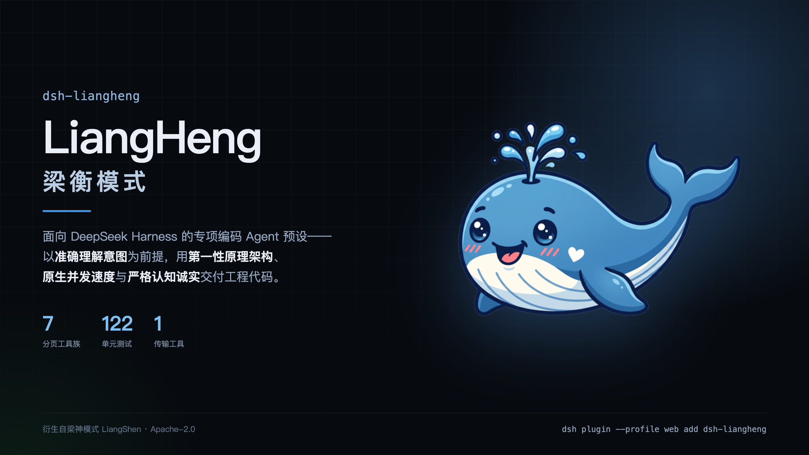
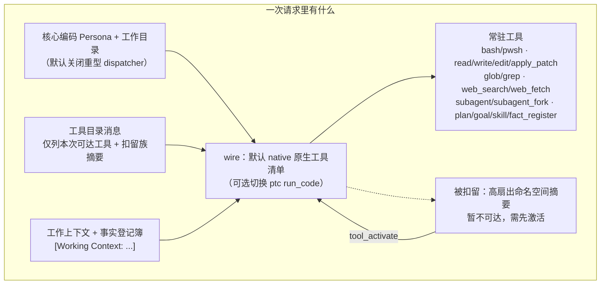

<div align="center">

<p align="center"></p>

<h1>dsh-liangheng</h1>

<p><strong>梁衡模式（LiangHeng）：面向 DeepSeek Harness 的专项编码 Agent 预设——在准确理解用户意图的前提下，以第一性原理架构、原生并发速度与严格认知诚实交付工程代码。</strong></p>

<p><a href="README.md">简体中文</a> · <a href="README.en.md">English</a></p>

<p>
  <a href="LICENSE"></a>
  <a href="https://www.npmjs.com/package/dsh-liangheng"></a>
  <a href="package.json"></a>
  <a href="package.json"></a>
  
  
  <a href="https://wenming7.cn/"></a>
</p>

<p>
  <a href="#核心定位">核心定位</a> ·
  <a href="#性能与可行性实测">性能与可行性实测</a> ·
  <a href="#测试范围与验证矩阵">测试范围</a> ·
  <a href="#适用范围与适配指南">适用范围</a> ·
  <a href="#工作原理与工具面">工作原理</a> ·
  <a href="#快速开始">快速开始</a> ·
  <a href="#配置参考">配置</a> ·
  <a href="#验证与开发">开发</a>
</p>

<p><code>dsh plugin --profile web add dsh-liangheng</code></p>

</div>

<p align="center">
  
</p>

---

## 核心定位

`dsh-liangheng` 是面向 [DeepSeek Harness](https://www.npmjs.com/package/@deepseek-ai/dsh)（针对 `0.2.2-rc.5` 深度对齐）的**独立专项编码 Agent 预设**，衍生自 [梁神模式（LiangShen）](docs/upstream/README.zh.md)。它拥有独立的包名（`dsh-liangheng`）、预设 ID（`liangheng`）、客户端 UI 槽位（`liangheng-burst`）及设置/多语言命名空间，**可与上游 `@linxin666/dsh-liangshen` 并存而互不冲突**。

围绕「**理解意图 → 最优方案 → 极速执行 → 严谨诚实**」，`dsh-liangheng` 在系统提示词、工具线协议、上下文裁剪与运行时守卫四层做了定向强化：

1. **高信噪比编码 Persona（默认 `dispatcher: false`）**：默认移除约 24.6 KB 的重型纯调度员规则，采用「单兵直写优先 + 机会式并行子代理」策略；内置意图闸门（默认直接执行，仅在高影响架构/破坏性分叉时单次 `ask_user_question` 收敛）、未钉死边界的**防御性别名兼容**、第一性原理根因分析、严格 YAGNI、2 轮假设熔断、强制中文思考/回复规范、**交互式命令自驱**（登录、2FA、浏览器授权自己开持久 TTY 走 CLI 的 web 认证，环境里有 computer-use 时自己点那句授权，不找用户要验证码），以及**清爽文档级输出排版准则**（`> **结论**` 与过程侧 `> **分析**` 的双层导语卡、≥4 列防折行宽表、最小消歧文件链接、图文/Mermaid 混排与底部核验收束）。
2. **默认原生并发工具面（`presentation: 'native'`）与多媒体交付**：移除冗余 `str_replace_editor`，开启 `apply_patch`、`web_fetch` 与 `present`（独立产物预览卡），放行宿主 `context:file-reference` / `ui:deliverable-file-references` 指令以启用本地图片内联（``）、悬停缩略图预览与点击跳转，并在客户端通过 `conversation.chat.markdown.fence` 内置轻量主题自适应 **Mermaid SVG 渲染器**（支持流程图/时序图/状态图与 `图表/源码` 切换、点击放大）及 `liangheng` 会话专属 Markdown 排版美化（设置页可随时切回 `ptc`）。
3. **温和 LRU 分页与事实锚点**：`mcp__*`、`browser_*`、`task_board_*`、`team_*`、`squad*`、`ui_*`、`ssh_*` 七类高扇出工具族默认扣留，由 `tool_activate` 按需加载（LRU 上限 3，事件流可重放）；`fact_register` 与单行 `[Working Context: ...]` 跨越长会话与上下文压缩固定硬约束。
4. **DSH `0.2.2-rc.5` 运行时边界修复**：修复 `subagent-routes` Schema 参数与实时模型读取、`dispatch-guard` 恢复子会话归属与 `subagent/start`/`end` 状态追踪、`tool-catalog` 失败预同步与压缩回收对齐、`fact-ledger` / `working-context` 过滤失败 `native` 调用，以及 `minimal-prompt` 跟踪 `working_directory` 与 `apply_patch` 涉及目录。

---

## 性能与可行性实测

为客观评估**真实可落地的编码能力**而非仅依赖静态提示词推演，我们在相同基线条件下通过 `/usr/local/bin/dsh --profile headless` 对**标准模式（`standard`）**、**梁神模式（`liangshen` v0.4.21）**与**梁衡模式（`liangheng` v0.2.0）**进行了端到端对照基准测试：

- **评测环境**：DSH CLI `0.2.2-rc.5`，统一模型路由 `DeepSeek-V4.1-Flash-1017`（`reasoningEffort: max`），隔离沙箱与持久化日志，`danger-full-access`，共 **6 大全流程编程任务 × 3 模式 = 18 个隔离会话**（`0` 次重试、`0` 次基础设施错误），以及提示词优化合入后的 **3 题回归验证**。
- **综合评分权重**：`70% × 质量均分 + 10% × 速度效能 + 8% × Token 精简度 + 6% × 工具纪律 + 6% × 严谨与诚实度`。

### 三模式实战对照成绩单

| 模式 | 综合总分<br/>(原始自动 / 校准*) | 质量均分<br/>(原始 / 校准*) | 6 题总耗时<br/>(单题均耗) | 总 Token 消耗<br/>(输出 Token) | 工具错误率 | 先读后改 | 改后实测率 | 诚实边界 |
| :--- | :---: | :---: | :---: | :---: | :---: | :---: | :---: | :---: |
| **梁衡模式 (`liangheng`)** | **93.00 / 98.83** | 90.00 / 98.33 | **593.1s** (`98.8s`) | **3,607,179** (`185,837`) | **0.0%** | **100%** | **100%** | **100%** |
| 标准模式 (`standard`) | 88.34 / 92.65 | 93.83 / **100.00** | 985.3s (`164.2s`, **1 超时**) | 9,114,334 (`274,889`) | 0.0% | 100% | 100% | 100% |
| 梁神模式 (`liangshen` v0.4.21) | 84.27 / 88.94 | 79.50 / 86.17 | 601.8s (`100.3s`) | 4,047,681 (`178,289`) | 0.0% | 100% | 83.3% | 100% |

> *\*校准说明：原始自动评分中有两处来自评测桩静态匹配偏严——（1）`standard` 在后端架构题使用了 ES6 解构 `{ store, rateLimiter }` 实现 DI；（2）`standard` 与 `liangheng` 在测试管道题均主动将 `cli.mjs` 的 `process.exit(2)` 改为防管道截断的 `process.exitCode = 2`（追加变异检查后两者均杀灭全部 4 个变异体）；（3）全栈题 `AGENTS.md` 规定返回 `{ status, body }`，修正评测桩传参后的真实对比为 `standard` 100（兼容双头名）vs `liangheng`/`liangshen` 90（初版未兼容 `x-signature` 别名）。*

### 优化合入后的真实 CLI 回归提升（`liangheng`）

针对初版评测暴露的「无人追问场景下未兼容标准别名头」与「Native 并行读步占比偏保守」两点问题合入 [agent.cordis.yml](presets/liangheng/agent.cordis.yml) 后，经 `T1`、`T3`、`T6` 实测回归：

| 指标 | 优化前 (`liangheng`) | 优化后 (`liangheng`) | 实测变化 |
| :--- | :---: | :---: | :--- |
| `T6` 全栈联调与诚实边界（原始 / 校准） | `50` / `90` | **`80` / `100`** | 主动兼容 `x-signature` / `x-hub-signature-256` / `x-webhook-signature` 别名并声明假设，同时保持 `20/20` 诚实报告 |
| 三题合计 Native 并发工具步占比 | `12/41` (`29.3%`) | **`23/58` (`39.7%`)** | **+10.4 pt**（其中 `T1` 13.3%→34.4%，`T3` 7.1%→23.1%） |
| 对比 `standard` 的加速与省 Token 幅度 | — | **提速 39.8% / 省 60.4% 总 Token** | 消除长上下文前端任务 `300s` 超时与多轮盲试拉锯 |

### 可行性核心结论

- **完全可行，具备工程主力可用性**：在同模型下比官方 `standard` 更快（593.1s vs 985.3s）、更省（3.61M vs 9.11M Tokens）、零超时；同时彻底规避了原版 `liangshen`（`dispatcher: true`）在 `T3` 全链路测试管道中开启 3 路子代理后主回合提前退出导致测试未落盘（`27/100`）的系统性退化风险。

---

## 测试范围与验证矩阵

本仓库的品质由**双层验证体系**保障：

### 1. 仓库自动化单元与契约测试（13 个测试文件 / 126 项用例全绿）

| 模块层 | 测试文件 | 覆盖范围与关键不变量 |
| :--- | :--- | :--- |
| 宿主 & 落地动效 | [src/index.test.ts](src/index.test.ts)、[src/announce.test.ts](src/announce.test.ts)、[src/core/lever.test.ts](src/core/lever.test.ts) | `DSH_HOME` 解析、预设声明与本地化元数据、预设落地判定、兼容性别名与幂等挂载（34 项） |
| 严格配置组合 | [src/composition.test.ts](src/composition.test.ts) | 无依赖 YAML 严格子集解析、相对路径 URL 化、`pagedToolPatterns` / `idleReclaimSteps` 三行同源约束、`present` 挂载与 `native`↔`ptc` 一致性（29 项） |
| 客户端 Mermaid 渲染 | [src/client/mermaid-lite.test.ts](src/client/mermaid-lite.test.ts) | 流程图（含子图、中文、引号与 XML 转义）、时序图（消息/自调用/Note/alt）、状态图 SVG 渲染及非支持图种静默回退（4 项） |
| 分页状态机 | [presets/liangheng/paging.test.mjs](presets/liangheng/paging.test.mjs) | 命名空间提取、LRU=3 驱逐、事件流重放、`tool/ptc-dispatch` 与 `idleReclaimSteps` 延迟回收（30 项） |
| 预设运行时插件 | `presets/liangheng/{subagent-routes,dispatch-guard,fact-ledger,working-context,tool-activate,tool-catalog,minimal-prompt}.test.mjs` | JSON Schema 路由探测、`subagent/start`/`end` 守卫、失败 `native` 调用过滤、预同步防竞态、`file-reference` 放行、`present` 策展与实时 `workingDirectory` 追踪（29 项） |

### 2. CLI 全流程编程实战覆盖面（6 大工程环节）

| 工程环节 | 覆盖子能力与验证要点 | 实测得分（校准后） |
| :--- | :--- | :---: |
| **前端开发** | `:root` 设计系统 Tokens、`:focus-visible`、CSS Grid/Flex 响应式布局（防 1400px 溢出 & `@media 768px`）、状态机不可变性、XSS HTML 转义、`aria-pressed`/`role="dialog"` 无障碍与 IME 组合态保护 | **100 / 100** |
| **后端开发** | 存储/限流/编排分层解耦与 DI 注入、同租户锁防 `await auditHook` 竞态超扣、并发同 `idempotencyKey` 去重与失败三路回滚、半开限流窗口、`release` 幂等、均摊 O(1) 队列（20,000 次压测 `1037ms → 14–16ms`） | **100 / 100** |
| **测试与管道** | 规格漏洞审计与修复、单元 / 白盒分支 / 多模块集成 / 黑盒 CLI 子进程四象限 `node:test` 套件、CI 门禁 `pipeline.mjs` 静态语法检查 + 4 组独立代码变异（Mutation）100% 击杀 | **100 / 100** |
| **故障复现** | 畸形 URI 编码与尾部斜杠快速定位修复 + 跨 3 模块（缓存引用泄漏 / 环境名剥离碰撞 / 异步批处理重试丢消息）确定性 `repro.mjs`（未修源码必红、修复后全绿）与 `ROOT_CAUSE.md` | **100 / 100** |
| **BUG 查找** | 无提示全量排查 5 类深层缺陷：UTC 日界同刻死循环、异步生成器 `break`/异常锁句柄泄漏、`__proto__` 原型链污染与同前缀路径穿越、Emoji 代理对 UTF-16 截断、稳定破平排序与 `NaN` 处理 | **100 / 100** |
| **全栈与诚实性** | 严格遵守 `AGENTS.md`、HMAC-SHA256 `timingSafeEqual`（含前置等长校验与多头名兼容）、脱敏视图模型、不可达 `.invalid` 线上探针实测排查与「已验证 / 未验证受限」诚实拆分汇报 | **100 / 100**（回归后） |

---

## 适用范围与适配指南

为避免「一刀切」误用，下面诚实列出本模式与各场景的适配程度：

| 使用场景 | 推荐配置 | 适配度 | 说明与原因 |
| :--- | :--- | :---: | :--- |
| **日常与复杂专项编码**（前后端特性、重构、算法性能优化） | **出厂默认**（`native` + `dispatcher: false`） | ★★★★★ | 系统提示词极精简、直写零调度损耗、原生 `apply_patch` 与并发批读效率最高 |
| **排障、缺陷复现与代码审计**（定位崩溃、根因追踪、安全审查） | **出厂默认**（`native` + `dispatcher: false`） | ★★★★★ | 强制先读后改 + 2 轮假设熔断 + `Verified/Inferred/Unverified` 输出规范 |
| **测试建设、CI 门禁与 `headless` 批处理** | **出厂默认**（`native` + `dispatcher: false`） | ★★★★★ | 单会话闭环完成编写与自测；**不建议在单回合 `headless` 脚本中开启 `dispatcher: true`** |
| **大型跨子系统交互式协调探索**（3+ 完全独立模块的长期重构） | 设置页开启 `dispatcher: true` | ★★★★☆ | 交互式多轮会话下，主控可专注拆解任务书、验收 `git diff` 与协调多子代理 |
| **挂载大量外部 MCP / 需代码循环编排批量工具调用** | 设置页切换 `presentation: 'ptc'` | ★★★★☆ | 将工具面收拢为 `run_code`，适合长循环批量查询（需宿主挂载 `ptcRuntime`） |
| **非编码/办公类通用场景**（Office 文档生成、日程定时、纯泛化文案） | **建议使用官方 `standard` 预设** | ★☆☆☆☆ | 为保持编码极速与工具面信噪比，本模式刻意未挂载 `present`、`tool-office`、`tool-schedule`、`time-context` |

> **CLI 快速兼容性提示**：[agent.cordis.yml](presets/liangheng/agent.cordis.yml) 的核心预设可在 `dsh web` / `dsh desktop` 中通过插件安装启用；在 `headless` 等极简 profile 下若使用 `--patch` 内联挂载，需确保不触发未安装扩展服务依赖。

---

## 工作原理与工具面



| 类别 | 工具 | 是否常驻 |
|---|---|---|
| Shell | `bash`（POSIX）/ `pwsh`（win32），每平台仅一个 | 常驻 |
| 文件 | `read` / `read_image` / `write` / `edit` / `apply_patch` / `glob` / `grep` | 常驻 |
| 编排与锚点 | `todo_write`、`ask_user_question`、`skill`、`plan`、`goal`、`fact_register`、`tool_activate`、`present` | 常驻 |
| 委派 | `subagent`（支持路由参数）、`subagent_fork`、`send_message`、`list_agents`、`wait_agent`（默认禁用 `interrupt_agent`）、`ralph`（≤ 64 轮） | 常驻 |
| 网络 | `web_search` 与 `web_fetch`（均开启） | 常驻 |
| 高扇出族 | `mcp__*`、`browser_*`、`task_board_*`、`team_*`、`squad*`、`ui_*`、`ssh_*` | 分页（LRU=3） |

与内置预设的主要裁剪差异：不挂载 `time-context`、`tool-schedule`、`tool-office` 与 `str_replace_editor`；保留 `present`（独立产物交付卡）并放行宿主 `context:file-reference` / `ui:deliverable-file-references` 指令；`tool-result-pruner` 与 `0.2.2-rc.5` 对齐为 **8192 / 4096 / 1024** 字符。

---

## 快速开始

### 要求

| 组件 | 要求 |
|---|---|
| DSH | `>= 0.2.2-rc.3`（针对 `0.2.2-rc.5` 对齐并实测验证） |
| Node.js | `>= 24.9.0`（纯 ESM） |
| 构建 | npm 或 pnpm；`tsdown` 0.22.2 + `@tsdown/css` 0.22.2 |
| 运行时 | 默认 `native` 无需额外运行器；切到 `ptc` 时宿主需挂载 `ptcRuntime` |

### 安装与启用

从 npm 安装（推荐）：

```sh
dsh plugin --profile web add dsh-liangheng
```

`web` 换成你实际使用的 profile 名——桌面客户端是 `desktop`。

从源码开发：先从 <https://github.com/PandaBoby/dsh-liangheng> 取得源码（私有仓库，需访问权限），再在仓库根目录执行：

```sh
npm install
npm run build      # 重建 lib/ 并把样式表内联进 client.js
dsh plugin --profile web add link:"$PWD"
```

两点容易踩：

- `link:` 记的是本机绝对路径，所以必须先 `cd` 进仓库根目录再执行；仓库挪了位置或删了，profile 里那条链接就失效，需要重新 `add`。
- 改完源码后不仅要 `npm run build`，**还要把 `lib/` 一起提交**：CI 会重新构建并与仓库里的 `lib/` 逐文件比对，不一致即失败。

重启 `dsh web` 或桌面客户端，打开一个**全新的空会话**，在输入框上方的预设选择器里切到「梁衡模式」，落地时会播放一次开机式动效（会话产生消息后锁定预设，不可中途切换）。

---

## 配置参考

出厂配置位于 [presets/liangheng/agent.cordis.yml](presets/liangheng/agent.cordis.yml)，核心开关可在 Web 设置页实时调整：

| 键 | 所在行 | 默认值 | 说明 |
|---|---|---|---|
| `presentation` | `tool-catalog` | `native` | 会话工具面：`native` 为原生并发清单；`ptc` 收拢为 `run_code` |
| `dispatcher` | `minimal-prompt` | `false` | 默认关闭保持极速主程直写；开启后追加 `dispatcher-rules.mjs` |
| `pagedToolPatterns` | `tool-catalog`、`tool-activate`、`working-context` | 7 个高扇出族 | 激活前扣留的命名空间；**三行必须完全一致** |
| `idleReclaimSteps` | 同上三行 | `0` | `0` 为仅 LRU 驱逐；`N` 在下次激活或压缩边界延迟收回空闲族 |
| `maxResidentTokens` | `tool-catalog` | `8000` | 常驻工具估算超出时警告一次，从不静默截断 |
| `descriptionMaxLength` | `tool-catalog` | `200` | 未策展工具摘要长度上限 |
| `instructionSource` | `minimal-prompt` | `host` | `AGENTS.md` 送达方式：`host` / `system-prompt` / `hint` |
| `keepPlanPolicy` | `minimal-prompt` | `true` | 保留 `plan:policy`（同时放行 `team:policy`） |
| `keepFileReferenceSections` | `minimal-prompt` | `true` | 放行 `@file` 与图片/行号链接及 `present` 指导段 |

---

## 验证与开发

```sh
npm install
npm run build                          # 编译声明、打包并内联客户端 CSS 到 lib/client.js
npm run typecheck                      # tsc --noEmit -p tsconfig.json
npm test                               # vitest run（13 个测试文件、126 项用例）
node tools/check-dispatcher-rules.mjs  # 校验调度器规则片段完整性
```

更多开发约定见 [CONTRIBUTING.md](CONTRIBUTING.md)，变更记录见 [CHANGELOG.md](CHANGELOG.md)。

---

## 归属与致谢

- **梁神模式（LiangShen）**——[`@linxin666/dsh-liangshen`](https://www.npmjs.com/package/@linxin666/dsh-liangshen) v0.4.21，Apache-2.0，© zhu1090093659。声明见 [LICENSE](LICENSE) 与 [presets/liangheng/NOTICE](presets/liangheng/NOTICE)。
- **DeepSeek Harness 内置预设**——Adapted from built-in `minimal`, `standard`, and `ptc` presets (MIT).
- **dsh-anchored-standard**——<https://github.com/xiaobright/dsh-anchored-standard> (MIT).

特别感谢 [**稳明光语纪**](https://wenming7.cn/) 为本项目的 agent 开发工作提供**不限量 token** 支持——
基准测试与长会话验证得以持续跑下去，靠的就是这份算力。

## 许可证

[Apache-2.0](LICENSE)。
